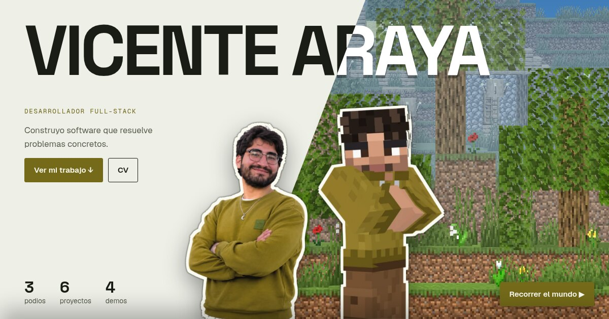

# Portfolio · Vicente Araya

**[vicente-araya.dev](https://vicente-araya.dev)**

[](https://vicente-araya.dev)

Dos cosas en una página. Arriba, una portada en texto: quién soy, experiencia,
proyectos y hackatones, para leer en un minuto. Detrás, **un mundo de bloques
que se recorre caminando**: el scroll desplaza el mundo de izquierda a derecha
y las secciones son lugares dentro de él.

Next.js 15, React 19 y TypeScript, sin librerías de animación: el mundo lo
mueve un bucle propio.

```bash
npm install
npm run dev     # http://localhost:3000
npm run build
npx tsc --noEmit
npm test
```

Pide Node 22.18 o posterior: los tests importan los `.ts` tal cual, sin
compilar.

## Cómo funciona

**El scroll es una posición, no una línea de tiempo.** Una sola
correspondencia `scroll → worldX` mueve las capas a distinta velocidad
(parallax) y decide qué está abierto. No hay disparadores ni estado que
sincronizar: todo es función de dónde estás.

**Las secciones son lugares.** Cada una tiene su bioma y su posición (`at`).
Cada bioma se **recorta a su territorio** en vez de fundirse con el vecino:
fundir por opacidad mostraba los dos terrenos a la vez —cactus sobre cerezos— y
dejaba pasar el cielo, porque dos capas al 50% componen un 75% y no un 100%. La
frontera dura tampoco es una concesión: en el juego los biomas cambian de golpe.

**Cada bioma tiene su clima.** Nieve en la taiga, tormenta de arena en el
desierto, pétalos en los cerezos. Partículas en canvas con profundidad, que el
avance del mundo arrastra. La tormenta además quita visibilidad al fondo, y
respira: en las calmas asoma el templo.

**Los paneles se abren por proximidad**, con histéresis para que un roce de
rueda no los haga parpadear. Van en un cajón a la derecha, con el mundo
oscurecido detrás: centrados tapaban al personaje justo al llegar a la sección.
Se navegan **con ratón y teclado, nunca con scroll** — el scroll pertenece al
mundo.

**En la taiga hay un podio.** Junto al cofre de proyectos, un escenario con
los hackatones. Se pulsa —lo avisa una medalla flotando a la entrada— y el
personaje camina hasta él, sube de dos saltos, se gira con la medalla puesta y
celebra. Al seguir camino baja saltando por el tercer puesto. Como sentarse,
va por tiempo y no por scroll.

**El recorrido acaba sentado en el acantilado.** Es lo único que no es una
posición: el gesto va por tiempo y el mundo se congela mientras dura, así que
al retroceder el personaje se levanta antes de empezar a desplazarse.

**La perla de ender** salta entre secciones. El corte de scroll ocurre mientras
la perla está fuera de pantalla, así que no hay nada que disimular.

**El bucle no pasa por React.** Todo lo que cambia cada frame —posición del
mundo, recortes, frame del sprite, clima— se escribe al DOM por referencias.
Como estado, React reconciliaba el árbol entero sesenta veces por segundo.

**Hay un modo ligero que se enciende solo.** Si el recorrido baja de 40 fps
—el caso típico es la aceleración por hardware desactivada— apaga los filtros
de las capas, fuerza media resolución y quita el clima. Sin GPU, esos filtros
obligan a repintar decenas de megapíxeles en cada frame.

## Portada y mundo

`/` abre con una portada: la pantalla partida en diagonal entre una página
sobria y el mundo, con todo el contenido debajo. «Recorrer el mundo» la
aparta y deja el mundo, que ya estaba montado detrás. Un enlace con ancla
(`/#contacto`) entra directo al mundo.

La portada es también lo que pone el contenido en el HTML servido. En el mundo
los paneles se montan al acercarse caminando, así que por sí solo no sirve
ningún proyecto a buscadores, previsualizaciones de enlace ni lectores de
pantalla. `/simple`, que cumplía ese papel, redirige a `/`.

Una dirección que no existe cae en el End: el personaje aterriza en una isla
flotando en el vacío, y al elegir una salida se tira de ella y el mundo lo
recibe cayendo del cielo.

## Estructura

```
src/app/page.tsx            el mundo: estado, montaje y poco más
src/app/not-found.tsx       la 404, en el End
src/app/recorrido.module.css
src/components/Cover.tsx    la portada, encima del mundo
src/components/             personaje, paneles, visores, perla, cielo, clima
src/content/portfolio.ts    proyectos, experiencia, skills, contacto
src/content/layers.ts       alto de cada capa y escala
src/world/                  el mundo por dentro: medidas y reglas sin React,
                            con tests, y los hooks que las usan (el bucle,
                            la entrada, el teletransporte, el vuelo)
tests/                      `node --test`, sin framework
scripts/import-layers.py    recorta y codifica los renders
scripts/render/             Blender por script: personaje, escenario, 404
public/layers/              capas de mundo por bioma (b1…b5)
public/sprites/             hojas de sprites del personaje
public/projects/            capturas de los proyectos
public/fonts/               Space Grotesk (SIL OFL), servida propia
```

El contenido está separado del recorrido a propósito: se puede añadir un
proyecto sin abrir el código de la animación.

## Assets

Los renders se producen en Mine-imator, todos al mismo lienzo de 3840×3000, y
`scripts/import-layers.py` los recorta y codifica. Las hojas del personaje son
la excepción: las genera `scripts/render/` con Blender sin ventana, a partir de
poses escritas como números, calcadas de las animaciones hechas a mano. Las reglas de cámara,
encuadre, montaje de hojas, la tubería de importación y los pendientes están en
**[ASSETS.md](./ASSETS.md)**.

La arquitectura por dentro, y las trampas que ya costaron una vez, en
**[CLAUDE.md](./CLAUDE.md)**.

## Créditos

Minecraft es de Mojang. Los bloques del mundo son renders hechos con sus
texturas, que no están en este repositorio; el personaje, su skin y sus
animaciones son propios, generados por `scripts/render/`. Sitio de fans, sin
relación con Mojang ni con Microsoft. Space Grotesk va bajo la SIL Open Font
License.
